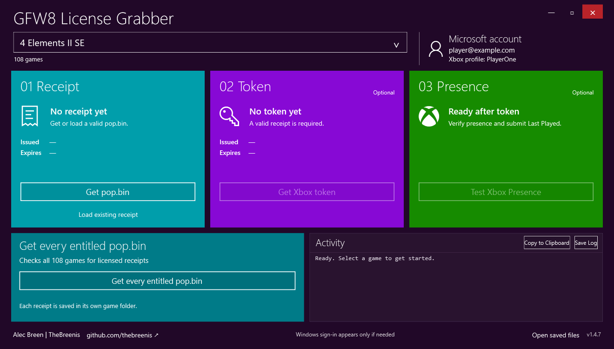

# GFW8 License Grabber

A Windows desktop tool for obtaining Windows Store `pop.bin` receipts and attempting legacy Xbox Live authentication for a catalogue of 108 games.

By **Alec Breen | TheBreenis**.



*App preview with example account details.*

Download **GFW8 License Grabber.exe** from [Releases](https://github.com/thebreenis/gfw8-license-grabber/releases/latest). The single executable includes its backend; no adjacent files or Python installation are needed to run it. Current version: **1.4.7**.

Prefer CMD? Download the separate **[GFW8LG-CLI.exe v1.0.0](https://github.com/thebreenis/gfw8-license-grabber/releases/tag/cli-v1.0.0)**. It offers a cyan/purple/green interactive menu, the same 108-game backend and safeguards, and scriptable commands:

```cmd
GFW8LG-CLI.exe --game "Dragon Mania Legends" --receipt --token
GFW8LG-CLI.exe --bulk
```

See the [CLI guide](docs/CLI.md) for receipt import, Presence, cancellation, exit codes, and offline demo mode. Both editions are single executables; close one before starting the other.

## Features

- 108 receipt entries and 108 token attempt configurations.
- Fresh receipts for installed or uninstalled games, plus signature-checked receipt import.
- Optional token acquisition and Presence testing for uninstalled games.
- Bulk receipt acquisition with success-only game folders and a summary of unlicensed/error results.
- Automatic Windows sign-in recovery when required; the user completes any credential prompt.
- Half-speed game-list scrolling, type-to-select, and Tab to commit the highlighted game.
- Private per-game output folders, token expiry, activity export, and a visible version label.

Seven token routes have been independently tested: Adera, Castle Siege, Dragon Mania Legends, Halo: Spartan Strike, Hexic, Hitman GO, and Jetpack Joyride. The other 101 configurations are experimental. Modern Combat 5 has package-confirmed legacy title metadata; Dungeon Hunter 5 uses an accepted candidate ID. Their live token tests were blocked by receipt entitlement. A configured route does not supply a license or guarantee service acceptance.

## Requirements and use

Windows 10/11 x64, Windows PowerShell 5.1, .NET Framework, and Windows Microsoft-account SSO. Windows must permit the temporary Appx helper registration. The app does not change that setting.

1. Choose a game and get a receipt, or load a valid existing receipt.
2. For an uninstalled game, optionally request an Xbox token. Complete any Windows sign-in prompt yourself.
3. Optionally test Presence. This changes Xbox activity and separately submits Last Played history. Temporary Presence is removed when the game was not already active.

Installed games support receipt acquisition only. Bulk operations acquire receipts only. Receipt imports enforce the Microsoft signature, edition, and a 24-hour policy from the issued timestamp. Token expiry comes from Xbox's response.

Files are saved privately under `%LOCALAPPDATA%\GFW8LicenseGrabber`. Receipts, bearer tokens, account data, saves, and private logs are not included in this repository or release. Keep your own token exports and private diagnostic logs private.

See [the user guide](docs/USER-GUIDE.txt) for details.

## Build from source

Install Python 3.10+ and run on Windows x64:

```powershell
python tools/build.py
```

The standard-library-only builder creates `dist/GFW8 License Grabber.exe` and `dist/GFW8LG-CLI.exe`, checks route metadata and runtime hashes, and verifies both embedded bundles. It uses the Windows .NET Framework C# compiler and includes the checked-in native helper/runtime dependencies. All paths are relative to the checkout. Use `python tools/build.py --cli-only` to build only the console edition.

To rebuild the native x86 helper as well, install Visual Studio C++ Build Tools and a Windows SDK with C++/WinRT headers:

```powershell
python tools/build.py --rebuild-native
```

The build updates the helper's exact hash pin and payload inventory in staging. The original Microsoft SDK binaries remain hash-checked. Compiler and packaging differences can change the EXE checksum; release checksums identify the published binary.

## Offline checks

After building:

```powershell
powershell.exe -NoProfile -MTA -ExecutionPolicy Bypass -File tests/Test-BulkFolders.ps1
powershell.exe -NoProfile -STA -ExecutionPolicy Bypass -File tests/Test-GamePicker.ps1
python tests/check_package.py
python tests/Test-CLI.py
```

These tests use synthetic receipt outcomes and a local WPF test window. They do not call Store/Xbox services, acquire real tokens, launch games, or alter game registrations. Historical sanitized release validations are in `docs/`; they record tested builds rather than promising universal compatibility.

## Source layout

| Path | Contents |
| --- | --- |
| `src/ui` | WPF/PowerShell GUI, launcher and supporting C# |
| `src/native` | C++/WinRT authentication helper source |
| `src/cli` | Standalone console launcher, menus and command-line interface |
| `src/metadata` | Retained manifests and additional-route provenance |
| `backend` | Receipt/token backend, catalogue and required runtime dependencies |
| `tools` | Portable build scripts |
| `tests` | Offline regression checks |
| `docs` | User guide and sanitized validation records |

See [third-party notices](THIRD-PARTY-NOTICES.md) for the bundled Microsoft components and artwork attribution.
